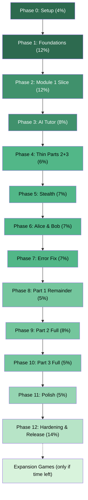
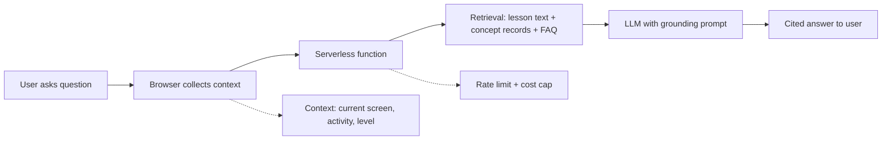

# Quantum Computing Learning App — Detailed Implementation Plan

## 🎯 Product Vision

A **mobile-first (Android) learning environment** for quantum computing with **three interconnected modes**:

| Mode | Purpose | Content |
|------|---------|---------|
| **🎮 Games** | Build intuition through interactive play | 19 games across Part 1 (concepts) and Part 2 (hardware) |
| **🔬 Simulations** | Experiment with quantum systems | 21 interactive labs with sliders, visualizations, math toggles |
| **📚 Learn** | Structured curriculum & assessment | 3-part curriculum: Concepts → Hardware → Math Companion |

**One-line definition:** *Games for intuition, Simulations for experimentation, Learn for structured mastery — all built around the same concept map, with a grounded AI Tutor that answers from the app's own lessons and notes.*

---

## 🏗️ Tech Stack

| Layer | Technology |
|-------|-----------|
| **Frontend** | Vite + React + TypeScript |
| **Mobile** | Capacitor (Android wrapper) |
| **State** | `localStorage` (local-first, optional sync later) |
| **Simulation Engines** | Custom JS/WASM (3 archetypes — see below) |
| **AI Tutor** | Serverless function → LLM API (key never reaches browser) |
| **Testing** | Vitest / Jest + engine regression tests |
| **Version Control** | Git with tags at every submit point |

---

## 🔧 Three Simulation Engine Archetypes

> [!IMPORTANT]
> These are NOT one universal physics engine. Each serves different simulations.

### Engine 1: State-Vector Circuit Engine
- **Scope:** 8–10 qubits max for interactive browser use
- **Gates:** H, X, Z, S, T, CNOT, parameterized rotations
- **Features:** Measurement sampling, Bloch sphere coordinates, state-vector display, "show the math" matrices
- **Used by:** Single-qubit lab, Circuit lab, Two-qubit lab, Bell & CHSH explorer, Teleportation lab, Deutsch–Jozsa explorer, Grover explorer, Gate Deck, Bloch Runner, Quantum Heist

### Engine 2: Optical/Interferometer Engine
- **Scope:** Discrete optical paths (beam splitters, mirrors, phase shifters)
- **Math:** Same 2×2 unitary matrix math as Engine 1 — spatial paths as basis states
- **Visual:** 2D optical/path renderer (different from circuit renderer)
- **Used by:** Photon Escape Room, Mach–Zehnder / Optical Circuit Lab

### Engine 3: Stabilizer/Tableau + Stochastic Noise Engine
- **Scope:** Polynomial-time Clifford simulation for larger error-correction demos
- **Features:** Stochastic noise models, logical vs physical error rate plotting
- **Used by:** Qubit Surgeon, Logical Qubit Builder, Noise Lab, Overhead Calculator

### Part 2 Hardware Labs
- Reuse the same **parameter/control/visualization UI framework**
- Use **modality-specific physics models** (rate equations, loss models, exchange-coupling dynamics, Ising/annealing schedules, blockade approximations)

---

## 📱 App Navigation Structure

```
Home  |  Games  |  Simulations  |  Learn  |  Progress
```

- **Home** = discovery layer (recently played, next lesson, cross-links, progress)
- **AI Tutor** = persistent "Ask" button on every screen (NOT a separate tab)
- **Progress** = Familiar / Explored / Mastered badges per concept

---

## 📋 Build Phases (from images — with time allocations & test gates)



### Submit Points (safe to demo/submit at each letter)
- **A** = Module 1 slice working (28% done)
- **B** = AI Tutor working (36% done) — *minimum demo*
- **C** = All three parts exist in thin form (42% done) — *real minimum target*
- **D** = Stealth game added (49% done)
- **E** = Alice & Bob game added (56% done)
- **F** = Error fix game added (63% done)
- **G** = Part 1 remainder complete (68% done)
- **H** = Part 2 fully built (76% done)
- **I** = Part 3 fully built (81% done)
- **Final** = Polished + hardened (100%)

---

## Phase 0: Setup (4%) 🟢

**What gets built:**
- Vite + React + TypeScript project scaffolding
- Capacitor Android project
- Android Studio configuration
- Antigravity rules file (stack, folder layout, honesty tags, mobile-first sizes)
- Test runner setup (Vitest)
- Git repo initialization

**Test gate before moving on:**
- [ ] A blank app installs on phone over USB
- [ ] Also runs in Chrome browser
- [ ] Git initialized with initial commit

> [!WARNING]
> Do this first — Android Studio's first setup is the biggest unknown.

**Folder structure:**
```
Qisket/
├── src/
│   ├── core/              # Simulation engines
│   │   ├── circuit/       # State-Vector Circuit Engine
│   │   ├── optical/       # Optical/Interferometer Engine
│   │   └── stabilizer/    # Stabilizer/Tableau Engine
│   ├── content/           # JSON content model (concepts, lessons, quizzes, games, sims)
│   ├── components/        # React UI components
│   │   ├── shell/         # App shell, tabs, navigation
│   │   ├── games/         # Game components
│   │   ├── simulations/   # Simulation lab components
│   │   ├── learn/         # Learn section components
│   │   ├── tutor/         # AI Tutor chat panel
│   │   └── shared/        # Honesty tags, concept cards, progress badges
│   ├── hooks/             # React hooks
│   ├── utils/             # Helpers, math utilities
│   └── styles/            # Global styles, palette (colorblind-safe)
├── public/
├── android/               # Capacitor Android project
├── tests/                 # Engine regression tests
├── package.json
├── vite.config.ts
├── capacitor.config.ts
└── tsconfig.json
```

---

## Phase 1: Foundations (12%) 🟢

**What gets built:**

### 1A. Circuit Core (State-Vector Engine)
- Gate implementations: H, X, Z, S, T, CNOT
- Measurement simulation with Born rule sampling
- Bloch sphere coordinate calculation from state vector
- State normalization and validation

### 1B. Content Model
- JSON schema for: Concept, Lesson, Quiz, Game, Simulation records
- Validation script that rejects bad records
- Records stored as JSON + Markdown

### 1C. App Shell
- Five-tab navigation: Home | Games | Simulations | Learn | Progress
- Responsive mobile-first layout
- Colorblind-safe palette
- Honesty-tag component (`Analogy` | `Simplified model` | `Accurate` | `Experimental/Contested`)

### 1D. Progress System
- `localStorage` persistence
- Familiar / Explored / Mastered state machine per concept
- Progress survives app restart

**Test gate:**
- [ ] `HXH = Z` passes
- [ ] Bell state gives 50/50, state stays normalized
- [ ] A bad content record fails validation
- [ ] Progress survives an app restart

---

## Phase 2: Module 1 Slice (12%) — Submit Point A

**What gets built:**

### 2A. Lesson Page Template
- Video embed with fallback link
- Written notes section
- Quiz component with scoring
- "Show the math" toggle

### 2B. Quantum Heist Game
- Simple 2-door superposition mechanic
- Bloch Aim final level (steer state arrow to target)
- Concept: qubits, superposition, Bloch sphere basics

### 2C. Single-Qubit Lab (Simulation)
- Amplitude sliders
- Draggable Bloch sphere
- Named-state buttons (|0⟩, |1⟩, |+⟩, |−⟩)
- "Match the target state" challenge
- Probability bar

### 2D. Module 1 Content
- Notes and quiz for "Qubits & Superposition"
- Linked video (Wired "5 Levels" segment)

**Test gate:**
- [ ] Playable end to end on the phone
- [ ] The lab agrees with the circuit core (|+⟩ gives 50/50)
- [ ] Video plays or fallback link opens
- [ ] Quiz saves its score

---

## Phase 3: AI Tutor (8%) — Submit Point B

**What gets built:**
- Serverless function holding the API key (key NEVER reaches browser)
- Chat panel UI (persistent "Ask" button)
- Context system: current screen, tag-matched concepts, activity summary, FAQ
- Quick-answers fallback for when API is unavailable
- Consent notice and toggle
- Rate limit and spending cap
- Grounding rules in system prompt
- Misconception library (seeded with ~10 common misconceptions)
- "Explain at my level" setting (Beginner / Intermediate / Math-ready)

**Test gate:**
- [ ] 20-question test set passes (in-scope, paraphrased, out-of-scope, misconception, prompt-injection)
- [ ] Airplane mode shows the fallback
- [ ] API key is not in the built app files

### Extra, only if time is left: "Ask about the video"
Not part of the Phase 3 gate. Do it after the tutor works, and cut it first if behind.

- **Video notes, made once ahead of time.** A script (run on one dev machine, key in an environment variable) sends each lesson video, or just the clip we use, to Gemini as a public YouTube link with a start and end time. It asks for timestamped notes: what is said, which diagram appears at which `MM:SS` and what it shows, and the key terms.
- **Human review.** A teammate reads and corrects the notes, because AI descriptions of diagrams can be wrong. Reviewed notes join the tutor's module document as chunks tagged with module, video id and time range, so the tutor still answers only from approved content.
- **"Ask about this moment" button** on the video card. The player already reports the current time, so the tutor opens with the video and timestamp filled in and searches the notes within about a minute of it ("At 3:12 the diagram shows ...").
- **Optional screenshot.** A button to attach the learner's own phone screenshot of a diagram, sent to Gemini as an image. The app cannot capture the YouTube player itself. Add a line to the consent note that images go to Google.
- **Why not the live video per question:** a clip costs roughly 100 to 300 tokens per second of video, so one question could use tens of thousands of tokens; the free tier also caps YouTube video at 8 hours per day, and the feature is in preview. Notes made once are cheap, reviewable and work in the offline fallback.
- **Keep it respectful:** short notes, credit the channel, link the original, never copy the videos.
- **Test gate (if built):** 5 questions about specific video moments get a correct, timestamp-grounded answer; notes for every video have been reviewed.

---

## Phase 4: Thin Parts 2 + 3 (6%) — Submit Point C

**What gets built:**

### Part 2 (thin)
- Shell page for Part 2
- Module 0 page: "What makes a good qubit?"
- Qubit metrics lab (slider template): T1, T2, gate time, gate error → depth budget
- Comparison data file (JSON with sources + dates)

### Part 3 (thin)
- Shell page for Part 3
- Week 0 primer page
- Lesson 1: State vectors and Dirac notation (notes + quiz)
- Matrix-entry checker component

**Test gate:**
- [ ] Matrix checker accepts equivalent answers, rejects wrong ones
- [ ] Slider lab responds to input
- [ ] All three parts (1, 2, 3) are reachable from Learn tab

> [!IMPORTANT]
> By Point C, all three parts exist in thin form. Any submission after this includes Parts 1, 2, and 3. **Protect this milestone.**

---

## Phase 5: Schrödinger's Stealth (7%) — Submit Point D

**What gets built:**
- Stealth game (measurement, probabilities, basis flashlights)
- Shots + histogram simulation lab
- Circuit lab (gates and phase)
- Modules 2–3 notes and quizzes

**Test gate:**
- [ ] Histograms match predicted probabilities
- [ ] Gate sequences agree with the circuit core

---

## Phase 6: Alice & Bob (7%) — Submit Point E

**What gets built:**
- Alice & Bob: Escape Together game (entanglement, Bell ideas, CHSH)
- Two-qubit lab simulation
- Bell & CHSH explorer simulation
- Module 5 pages (5A and 5B as text)

**Test gate:**
- [ ] Classical strategies cap at 75%
- [ ] Quantum strategy reaches about 85%

---

## Phase 7: Error Fix (7%) — Submit Point F

**What gets built:**
- Qubit Surgeon game (noise, parity checks, error correction)
- Noise lab simulation (3-qubit repetition code)
- Module 7 explainer

**Test gate:**
- [ ] Logical error rate beats physical error rate at low noise
- [ ] Formula: $3p^2 - 2p^3$ against $p$

---

## Phase 8: Part 1 Remainder (5%) — Submit Point G

**What gets built:**
- Module 0 orientation (Hype Check card sort)
- Module 4 interference page with Mach–Zehnder lab
- Module 6 page with Deutsch–Jozsa (phase oracle) and Grover explorers
- Optical/Interferometer engine for Mach–Zehnder

**Test gate:**
- [ ] Mach–Zehnder bright and dark ports match the core for a given phase
- [ ] Grover's success probability peaks near $\frac{\pi}{4}\sqrt{N}$ iterations, then falls

---

## Phase 9: Part 2 Full (8%) — Submit Point H

**What gets built:**
- Pages and quizzes for every Part 2 module (0–9)
- Verified video links
- Remaining hardware labs: Transmon, Loss budget, Overhead calculator, Rydberg blockade, Exchange coupling, Annealing
- Comparison dashboard (sourced + dated figures)
- Honesty tags corrected (photonic cryogenics, ion connectivity, annealing vs gate-model)

**Test gate:**
- [ ] Every figure has a source and date
- [ ] Loss-budget success probability falls as expected
- [ ] All links work

---

## Phase 10: Part 3 Full (5%) — Submit Point I

**What gets built:**
- Lessons 2–5 with notes, problem sets, quizzes
- Matrix/symbolic grader fully functional
- Links to external courses for advanced topics

**Test gate:**
- [ ] Every problem has at least one equivalent accepted answer
- [ ] All 5 lessons complete with problem sets

---

## Phase 11: Polish (5%)

**What gets built:**
- Progress screen with badges
- Simple concept search and map
- First-run Play / Experiment / Study routing
- Related-concept links between modes
- "Coming soon" labels for unbuilt items
- Accessibility: colorblind-safe palette, non-color cues, no-timer modes, text size, small-screen layout

**Test gate:**
- [ ] Every screen reachable in three taps
- [ ] No information depends on color alone
- [ ] Looks right on a small phone

---

## Phase 12: Hardening & Release (14%) — Final Submit

**What gets built:**
- Full playthrough on phone
- Offline run test
- Link and video check
- Tutor re-test (20-question set)
- APK build and install on second phone
- Backup screen recording of demo
- README with install steps
- Git tag

**Test gate:**
- [ ] Fresh install from APK works using only documented steps
- [ ] A 15-minute free-play session doesn't crash

---

## 🎮 Complete Game Catalog (19 Games)

### Part 1 — Concept Games (10)
| # | Game | Concepts | Engine |
|---|------|----------|--------|
| 1 | Quantum Heist | Qubits, superposition, Bloch sphere | State-Vector |
| 2 | Schrödinger's Stealth | Measurement, probabilities, bases | State-Vector |
| 3 | Bloch Runner | Single-qubit gates, rotations, phase | State-Vector |
| 4 | Photon Escape Room | Interference, phase, beam splitters | Optical |
| 5 | Alice & Bob: Escape Together | Entanglement, Bell, CHSH | State-Vector |
| 6 | Teleport Relay | Teleportation, no-cloning | State-Vector |
| 7 | Gate Deck | Gate combinations, circuit reasoning | State-Vector |
| 8 | Oracle Detective | Oracles, Deutsch–Jozsa | State-Vector |
| 9 | Qubit Surgeon | Noise, parity, error correction | Stabilizer |
| 10 | Hype Check | Where QC helps / doesn't | None (card sort) |

### Part 2 — Hardware Games (9)
| # | Game | Concepts | Hardware |
|---|------|----------|----------|
| 11 | Coherence Race | T1/T2, gate speed, depth budget | Generic |
| 12 | Cool Down | Cryogenics, heat vs qubits | Superconducting |
| 13 | Ion Chain Conductor | Connectivity, SWAP overhead | Trapped ions |
| 14 | Tweezer Shuffle | Optical tweezers, blockade | Neutral atoms |
| 15 | Photon Factory | Loss, probabilistic gates | Photonic |
| 16 | Dot Tuner | Gate voltages, exchange coupling | Silicon spin |
| 17 | Valley Roll | Annealing, tunneling | Quantum annealing |
| 18 | Logical Qubit Builder | Physical vs logical qubits | Error correction |
| 19 | Quantum Architect | Hardware trade-offs (capstone) | All modalities |

---

## 🔬 Complete Simulation Catalog (21 Labs)

### Part 1 Simulations (12)
| Lab | Core Interaction |
|-----|-----------------|
| Single-qubit lab | Amplitude sliders, Bloch sphere, target-state matching |
| Measurement shots + histogram | Shot count slider, Z/X basis toggle, predicted vs observed |
| Circuit lab + Bloch sphere | Gates → rotations, phase view, global-phase toggle |
| Mach–Zehnder / optical circuit lab | Phase/beam-splitter controls, bright/dark ports, circuit-view toggle |
| Two-qubit lab | H + CNOT, 4 amplitude bars, state-space doubling |
| Bell & CHSH explorer | Measurement angles, 75% classical vs ~85% quantum |
| Teleportation lab | Step-through protocol, verify received state |
| Deutsch–Jozsa explorer | Pick oracle, run 1 quantum query vs classical |
| Grover explorer | Iteration slider, success probability rise + overshoot |
| Period-finding visual | Interference peaks reveal period (idea-level) |
| Noise lab | Noise + correction settings, logical vs physical error plot |
| Double-slit visual | 2D interference pattern (secondary/optional) |

### Part 2 Simulations (9)
| Lab | Core Interaction |
|-----|-----------------|
| Qubit metrics lab | T1, T2, gate time, gate error sliders → depth budget |
| Transmon lab | Drive strength → Rabi oscillations, T1/T2 decay |
| Topology compiler | Same circuit on grid/line/all-to-all → SWAP count |
| Rydberg blockade | Inter-atomic distance slider → blockade on/off |
| Loss budget | Loss-per-component slider → exponential success drop |
| Exchange-coupling lab | Barrier height + time → swap oscillations → entangling gate |
| Annealing | Anneal-time slider on small Ising problem |
| Overhead calculator | Physical error rate + target → qubit count needed |
| Comparison dashboard | Side-by-side vendor specs from versioned JSON |

---

## 📚 Learn Curriculum Structure

### Part 1 — Concepts (Modules 0–7)
| Module | Topic | Game | Simulation |
|--------|-------|------|-----------|
| 0 | Why quantum? (orientation) | Hype Check | — |
| 1 | Qubits & superposition | Quantum Heist | Single-qubit lab |
| 2 | Measurement | Schrödinger's Stealth | Shots + histogram |
| 3 | Gates | Bloch Runner | Circuit lab + Bloch |
| 4 | Phase & interference | Photon Escape Room | Mach–Zehnder lab |
| 5A | Entanglement & Bell tests | Alice & Bob | Two-qubit + CHSH |
| 5B | Entanglement as resource | Teleport Relay | Teleportation lab |
| 6A | Circuits & oracles | Gate Deck + Oracle Detective | Deutsch–Jozsa explorer |
| 6B | Search & period finding | — | Grover + period-finding |
| 7 | Noise & error correction | Qubit Surgeon | Noise lab |

### Part 2 — Hardware (Modules 0–9)
Covers: What makes a good qubit → Superconducting → Trapped ions → Neutral atoms → Photonic → Silicon spin → Annealing → Frontier ideas → Physical to logical → Capstone

### Part 3 — Math Companion (Optional, 5 lessons)
State vectors → Gates as matrices → Multiple qubits → Measurement/interference → Grover's algorithm

---

## 🤖 AI Tutor Architecture



**Key rules:**
- Answer ONLY from approved content (lessons, concept records, game/sim descriptions)
- Cite source in every answer
- Respect learner level (Beginner / Intermediate / Math-ready)
- Correct misconceptions gently with links
- API key in serverless function only — never in browser

---

## 🚀 Competition Demo Script (3 minutes)

| Time | Beat | What's shown |
|------|------|-------------|
| 0:00–0:20 | Hook | Problem: QC learning = vague analogies OR heavy math |
| 0:20–1:10 | Play | Photon Escape Room: guaranteed path goes dark + "Accurate" tag |
| 1:10–1:50 | Experiment | Mach–Zehnder lab: change phase, "show the math" |
| 1:50–2:30 | Study + Ask | Learn lesson + quiz + AI Tutor cross-module question |
| 2:30–2:40 | Vision | Full curriculum map with status labels |
| 2:40–2:50 | Proof | Pre/post misconception results |
| 2:50–3:00 | Close | One-line definition |

---

## ⚠️ Critical Rules & Guardrails

### If You Fall Behind — Cut in This Order:
0. "Ask about the video" tutor extra (video notes, Ask-about-this-moment button, screenshot attach)
1. Expansion games
2. Part 2 labs beyond the first
3. Part 3 problem sets beyond Lessons 1–2
4. Extras in Part 1 (Hype Check, period-finding visual)
5. Error fix game (keep Module 7 explainer + noise lab)
6. Alice & Bob game (keep Module 5 pages + Bell lab)

### Never Cut:
- Setup & core tests
- Module 1 slice
- AI Tutor with fallback
- Thin Parts 2 and 3
- Hardening

### Using Antigravity (from the plan):
- Write rules file in Phase 0: stack, folder layout, test expectations, honesty tags, mobile-first sizes
- Fix core module function signatures in Phase 1, then run parallel agents on separate areas
- Start each task in Plan mode and read the plan before approving
- Tag Git at every lettered point — keep an APK for each tag
- Generation is fast, testing is the bottleneck — play every game on a real phone at its gate

### Running in Parallel:
- Content is the slow part, not code
- While testing one phase, have a second agent draft notes, quizzes, concept records, quick answers, and FAQ for the next phase
- You review accuracy — don't leave content to the end

---

## 🔑 Open Questions Before Starting

1. **What is the deadline?**
2. **How many people are building?**
3. **What are the judging criteria and demo time limit?**
4. **Does the timeline allow for Stretch items (Gate Deck + extra sims)?**
5. **Which LLM provider for the AI Tutor?** (affects serverless function setup)
6. **Any existing design assets or brand guidelines?**
